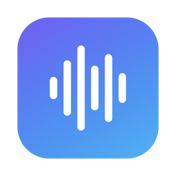

<p align="center">
  
</p>

<h1 align="center">Swell</h1>

<p align="center">
  <a href="../../releases/latest"></a>
  
  
  
  <a href="LICENSE"></a>
</p>

Hold **right ⌘**, speak, let go — your words are typed wherever your cursor is.

A free, open-source, fully local take on voice dictation apps like [Wispr Flow](https://wisprflow.ai).

Swell runs OpenAI's Whisper speech recognition **entirely on your own machines**: on your Mac's Neural Engine (via [WhisperKit](https://github.com/argmaxinc/WhisperKit)), or on a Linux PC's GPU (via [faster-whisper](https://github.com/SYSTRAN/faster-whisper)). No cloud, no account.

Swell comes for **macOS** and **Linux**. A Linux PC with a GPU can also transcribe for your Mac over [Tailscale](https://tailscale.com), so the Mac gets a bigger model without spending its own memory or battery.

## Features

- **Hold-to-talk anywhere** — right ⌘ (or right ⌥) in any app; text is pasted at the cursor and your clipboard is restored.
- **Animated on-screen pill** while you speak and while it transcribes.
- **Choose your model** — download, switch and delete Whisper models in the app.
- **Use a more powerful machine** — send your speech to Swell on a Linux PC with a GPU over Tailscale, for a bigger model at the same speed. If it's asleep, your Mac transcribes instead.
- **Lives in the menu bar** — in the Dock and ⌘Tab only while its window is open; quit from the menu bar icon.
- **Launch at login** (starts silently) and **load model at start** toggles.
- **Battery friendly** — ~0% CPU when idle; the microphone is only on while you hold the key.

## Install

1. Download the latest **Swell-x.y.z.dmg** from [Releases](../../releases/latest).
2. Open it and drag **Swell** into **Applications**.
3. Open Swell. Because it isn't notarized by Apple, macOS blocks the first launch — go to **System Settings → Privacy & Security** and click **Open Anyway**.
   Or from Terminal: `xattr -dr com.apple.quarantine /Applications/Swell.app`
4. Allow **Microphone** and **Accessibility** (needed to detect the hotkey and paste).

Requires an **Apple Silicon** Mac on **macOS 14 Sonoma or later**.

## Models

| Model | Download | Notes |
|---|---|---|
| Tiny | 77 MB | Fastest, good for short notes |
| Base | 147 MB | Better accuracy, still instant (default) |
| Small | 217 MB | Best accuracy for longer dictation |

Models download from [argmaxinc/whisperkit-coreml](https://huggingface.co/argmaxinc/whisperkit-coreml) into `~/Library/Application Support/Whisper/Models`. Switching keeps the current model working until the new one is ready.

## Use another machine

1. Install [Tailscale](https://tailscale.com/download) on both computers and sign in with the same account.
2. On the Linux PC, install [Swell for Linux](#swell-for-linux), open it, turn on **Serve other machines**, and click **Copy pairing link**.
3. On the Mac, open Swell › **Engine** › **Add Machine…** and paste the link. Or open the link on the Mac and confirm.

The machine shows as **Online** with its model and round-trip time. Under **Rephrasing**, choose how much it tidies your words: Off, Low (drops "um" and "uh" only), Medium, or High (polished sentences). Pick **This Mac** or the machine in Settings or the menu bar. The link carries a secret token, so share it only with your own devices; Swell keeps it in `~/Library/Application Support/Swell/machines.json`, readable only by you.

## Troubleshooting

| Problem | Fix |
|---|---|
| Nothing is pasted | Accessibility is off or stale: in **Privacy & Security → Accessibility**, remove Swell with **−**, add it again with **+**. Your text is on the clipboard meanwhile (⌘V). |
| Empty or cut-off text with AirPods | Bluetooth mics drop the first ~0.75 s. Pick the built-in microphone in Swell → Dictation → Microphone (the default). |
| A machine shows **Offline** | Make sure it's awake, Swell is running there with **Serve other machines** on, and Tailscale is connected on both. Click ↻ to test again. |
| Popup asks for Accessibility every launch | Same as "Nothing is pasted" — remove and re-add the entry. |

Logs: `/usr/bin/log show --last 10m --predicate 'subsystem == "com.samirgiripunje.whisper"'`

## Swell for Linux

Hold **right Ctrl** to dictate. Copy some text, then hold **right Alt** and say what to write, and Swell writes it with OpenAI (needs `OPENAI_API_KEY`). **Rephrase dictation** goes from Off to High: Low only drops "um" and "uh", while Medium and High tidy or polish the text with a local [Ollama](https://ollama.com) model. Needs X11 and, for speed, an NVIDIA GPU.

```bash
git clone https://github.com/Samir-Giripunje/swell.git ~/Developer/swell
~/Developer/swell/apps/linux/install.sh
```

Open **Swell** from your app menu to load a model, start it at login, and turn on **Serve other machines**. Logs: `~/.cache/swell/swell.log`.

## Build from source

The repository holds both apps and the protocol between them:

| Path | What |
|---|---|
| [`apps/macos`](apps/macos) | Swell for Mac (Swift, SwiftUI, WhisperKit) |
| [`apps/linux`](apps/linux) | Swell for Linux (Python, faster-whisper, GTK) |
| [`packages/protocol`](packages/protocol) | How one Swell transcribes on another: HTTP API, JSON schema, shared test fixtures |

```bash
git clone https://github.com/Samir-Giripunje/swell.git
cd swell
apps/macos/build.sh             # builds and installs /Applications/Swell.app
```

Requires Xcode 16+. To package a DMG: `brew install create-dmg`, then `apps/macos/build.sh --no-install && VERSION=0.0.1 apps/macos/scripts/make_dmg.sh`.

End-to-end self-test (opens TextEdit, dictates a spoken phrase, reads it back, then quits):

```bash
open -a /Applications/Swell.app --args --self-test
```

Linux tests run without a GPU: `cd apps/linux && uv run --only-group dev pytest`.

## Releasing

Push a tag; GitHub Actions builds, signs, packages the DMG and publishes the release.

```bash
git tag v0.0.2 && git push origin v0.0.2
```

## Credits

- **[Wispr Flow](https://wisprflow.ai)** — the hold-to-talk dictation experience and on-screen pill that inspired Swell. Swell is an independent project and is not affiliated with or endorsed by Wispr.
- **[WhisperKit](https://github.com/argmaxinc/WhisperKit)** by Argmax (MIT) — on-device Whisper inference on the Neural Engine.
- **[faster-whisper](https://github.com/SYSTRAN/faster-whisper)** by SYSTRAN (MIT) — Whisper on NVIDIA GPUs for Swell on Linux.
- **[Whisper](https://github.com/openai/whisper)** by OpenAI (MIT) — the speech recognition models.

## License

[MIT](LICENSE)
